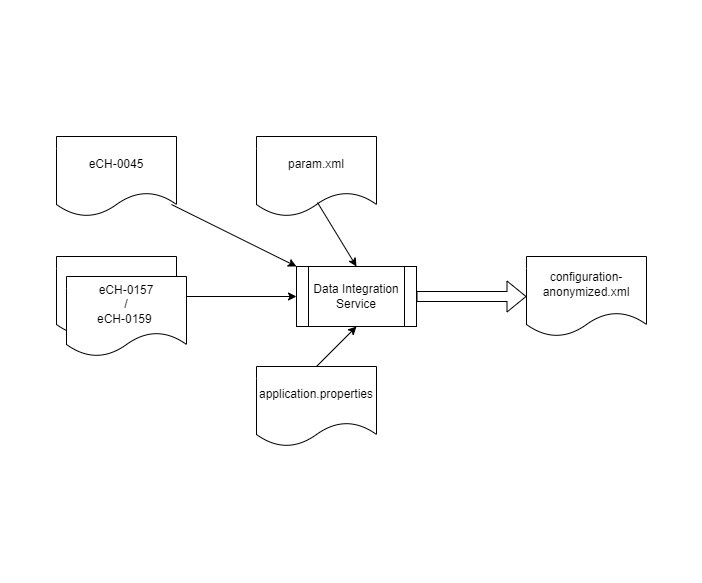

# Data Integration Service

## What is the Content of this Repository?

The Data Integration Service is a tool designed to process XML files describing the electoral roll and the configuration of election events. The tool
produces a single, unified XML file that the Swiss Post Voting system can use. The XML files processed by the service follow the eCH-standard, an open
E-Government standard used in Switzerland.

The standard defines a set of XML schemas that describe various types of data, such as the electoral roll and the configuration of election events.
One of the key features of the Data Integration Service is its ability to handle variations in the XML files it processes. The XML files may differ
slightly from one customer to another and come in different versions. Additionally, the service can enrich the data in the XML files with additional
information.

We use the following eCH-standards (<https://www.ech.ch>):

* eCH-0045 for the electoral roll
* eCH-0157 for an election
* eCH-0159 for a vote (referendum-style).

The data integration service can process large amounts of data by optimizing memory usage via streams.

XML (eXtensible Markup Language) files are widely used as an interface between different systems due to their ability to facilitate easy content
validation. The open eCH-standard also utilizes XML files as its primary format for data representation.

The use of XML files as an interface between different systems allows for the validation of the content of the files in a consistent and standardized
manner.

The configuration file “param.xml” contains the following definitions for the SDM:

* voting period
* electoral board
* specific election definitions (candidate-accumulation, write-ins)
* extended authentication mode (birthyear / birthdate)

The properties file “application.properties” contains the following definitions:

* min number of days allowed between eVoting from and eVoting to
    * eVotingFromTo.min.delta.allowed=10
* grace period in seconds
    * authorization.gracePeriod=900
* counting circles
    * countingCircle.testControl.minValue=10000



## Security Considerations

The Data Integration Service operates within the cantonal infrastructure under [strict operational and procedural security](https://gitlab.com/swisspost-evoting/e-voting/e-voting-documentation/-/blob/master/Operations/Recommendation_Safety_Measures_Cantonal_Infrastructure.md?ref_type=heads). For example, it runs on a hardened, offline machine under a strict four-eyes principle.

## Test Data

Test data is available in the [testdata repository](https://gitlab.com/swisspost-evoting/e-voting/testdata).

## Usage

The data integration service is a command-line Spring Boot tool that is packaged inside a zip file produced upon compilation. The zip file contains
the following:

* an embedded JRE to run the service
* the data integration service jar file

To run the service you can use the following command in the command line:

```bash
embedded-jre/bin/java.exe -Dbypass.checkConsistency.dates=<true|false> -Ddirect-trust.keystore.location=<canton_keystore.p12> -Ddirect-trust.password.location=<canton_keystore_pw.txt> -Ddirectory.source=<src_directory> -Ddirectory.target=<target_directory> -jar data-integration-service-x.x.x.x.jar
```

In the source directory, the following files must be present:

* eCH-0045 XML file(s)
* eCH-0157/9 XML file(s)
* params.xml, configures the data integration service, by activating plugins, and provides additional election event parameters that are not present
  in the eCH-files

When running the data integration service, the following files will be created:

* In the target directory:
    * configuration.xml
    * configuration-anonymized.xml
* In the directory from which the java command is run:
    * a log file (data-integration-service.log)

## Development

```bash
mvn clean install
```
